# Architecture

How the operator, its admission webhooks, the TLS CSI driver and the NiFi pods fit together, and
the order in which a reconcile works. Four diagrams, from the whole system down to one reconcile.
Details live in the topic docs linked from each section.

## 1. System overview

- A platform team applies `NiFiCluster` resources (`nifi.ksolves.com/v1alpha1`)
  with kubectl, Helm or a GitOps tool such as Argo CD.
- The Kubernetes API server checks them against the CEL rules in the CRD schema, then calls the
  operator's admission webhooks to default and validate them.
- The operator manager reconciles each `NiFiCluster` into a running NiFi cluster in the
  cluster's namespace.
- The TLS CSI driver gives every NiFi pod its own certificate, signed by that cluster's CA.
- NiFi elects its cluster coordinator and primary node through Kubernetes Leases and keeps
  cluster state in a ConfigMap, so no ZooKeeper is needed; see
  [Cluster coordination](cluster-coordination.md).
- Users and data sources reach NiFi over HTTPS. Login is NiFi's single-user login; see
  [NiFi login credentials](authentication.md).

## 2. Inside the operator

- **Admission webhooks** run on every operator replica, so they keep answering when one replica
  is down. They validate and default both resources, and use SubjectAccessReview to check that
  the requesting user may create pods and read the Secrets the cluster references. They also
  enforce trusted image repositories, reserved names, fixed volume sizes and an immutable
  coordination backend.
- **Reconciler** runs only on the elected leader. It reconciles `NiFiCluster` and owns the
  StatefulSets, Services, ConfigMaps, Secrets, PodDisruptionBudgets, ServiceAccounts, Roles and
  RoleBindings it creates. It also watches `NiFiNodeGroup` objects and referenced Secrets,
  and maps their events to the owning cluster.
- **Per-cluster CA**: each cluster's CA is a Secret in the cluster's namespace, controlled by the
  `NiFiCluster`. The CSI driver mints a per-pod certificate from it when the pod mounts its CSI
  volume; see [TLS](tls.md) and [CSI driver platform notes](csi-driver-platform-notes.md).
- **NiFi REST polling**: the operator reads NiFi's own cluster API, so `status` reports which
  nodes NiFi sees as connected, not just which pods are running; see [Status](status.md).
- **Metrics**: the operator exposes `/metrics`, including webhook certificate expiry. The chart
  ships a ServiceMonitor; alert rules are yours to write.

## 3. Inside a NiFi cluster namespace

- **Node group**: one StatefulSet for the cluster's node group, defined inline in
  `spec.nodeGroups`. `NiFiNodeGroup` objects of earlier versions still run as node groups of their
  cluster; new ones are rejected (see [NiFiNodeGroup objects](autoscaling.md)).
- **Pods** run under Pod Security `restricted` with an arbitrary UID, and under `restricted-v2` on
  OpenShift. Nodes talk to each other over mutual TLS on the cluster protocol port.
- **Storage**: per-pod PVCs for the FlowFile, content, provenance and database repositories
  (split or single). PVCs are kept or deleted per the retention policy;
  see [Storage and retention](storage.md) and [Local volumes](local-storage.md).
- **Services and exposure**: a headless Service for peer DNS and a client Service (ClusterIP,
  or LoadBalancer) that your own Route, Ingress or HTTPRoute can point at; see
  [Exposing a cluster](exposure.md).
- **Coordination**: Lease-based coordinator and primary-node election plus a ConfigMap state
  provider. The operator creates the ServiceAccount, Role and RoleBinding NiFi needs for them.
  Coordinator failover takes about 15 seconds; see [Cluster coordination](cluster-coordination.md#lease-timing-and-failover).
- **Config and Secrets**: the operator renders `nifi.properties`, bootstrap, authorizers and
  logback into a ConfigMap. A change to the rendered config changes the pod template hash and
  rolls the nodes one at a time. Login, sensitive-properties key and CA access live in Secrets.

## 4. How a reconcile works

A change to a `NiFiCluster`, `NiFiNodeGroup` or referenced Secret starts a pass. In order:

1. Get the `NiFiCluster`. On delete, the finalizer applies the retention policy to PVCs and the
   sensitive-properties key.
2. Merge `NiFiNodeGroup` objects into the node-group list.
3. **Node limit**: while the node groups ask for more than 3 NiFi nodes in total, the operator
   still polls NiFi and writes status, but changes nothing else.
4. Prune removed node groups safely: decommission, offload, remove the node from NiFi, then
   delete the StatefulSet; see [Scaling](scaling.md).
5. Security prerequisites: TLS CA, CSI CA access, login Secrets, NiFi RBAC and the
   sensitive-properties key.
6. Coordination check: the backend is immutable and migrations are guarded.
7. Per node group: ConfigMap, StatefulSet, Services, PDB and PVC retention. A failure in
   one node group is recorded and the others still proceed.
8. Exposure: the cluster Service.
9. Poll the NiFi REST API for node states.
10. Write status, conditions and Events.
11. Follow-ups: node removal after scale-down, `NiFiNodeGroup` status.
12. Requeue, to keep polling NiFi.

## Components

| Component | Runs as | Where |
|---|---|---|
| Operator manager (reconciler, leader-elected) | Deployment | operator namespace |
| Admission webhooks | served by every operator replica | operator namespace |
| TLS CSI driver | DaemonSet | operator namespace, one pod per node |
| Cluster CA | Secret, controlled by the `NiFiCluster` | cluster namespace |
| NiFi nodes | one StatefulSet per node group | cluster namespace |
| Coordination | Leases + ConfigMap | cluster namespace |

| Port | Use |
|---|---|
| 8443 | NiFi HTTPS (UI, REST API) |
| 11443 | NiFi cluster protocol (mutual TLS) |
